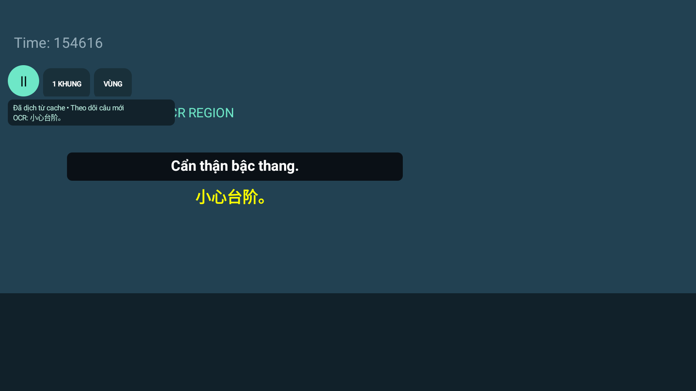
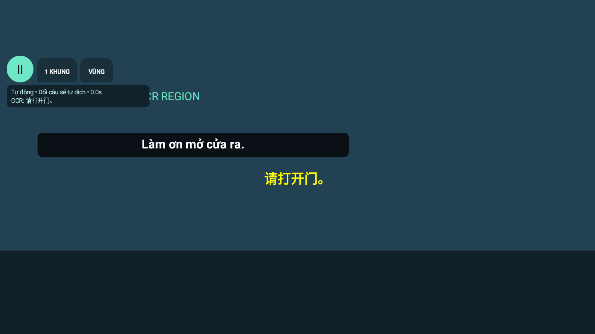
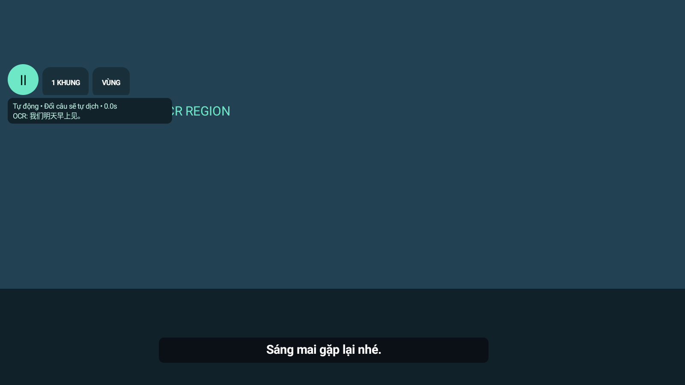
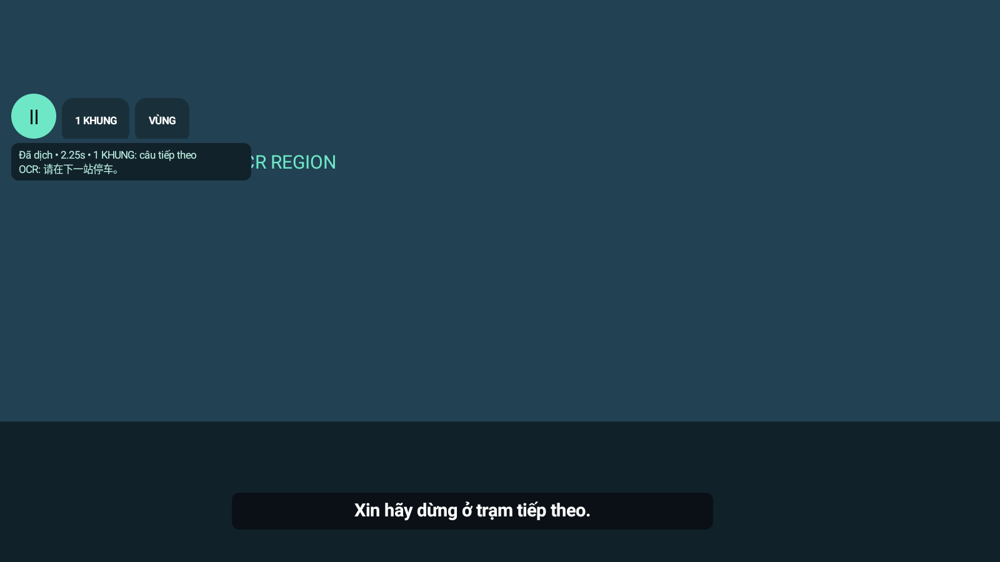
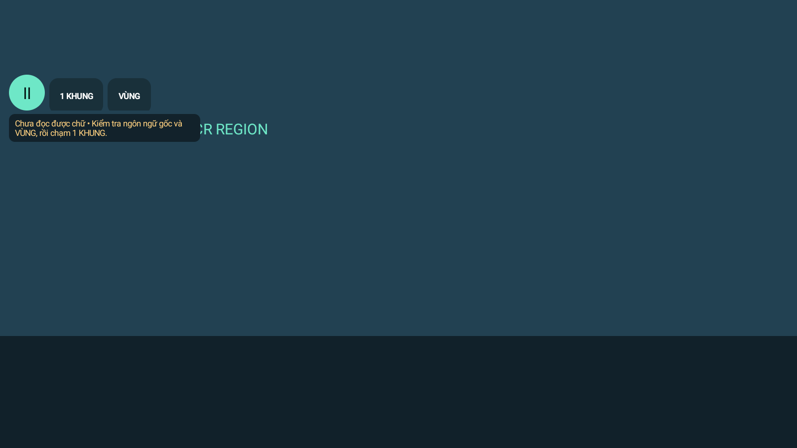
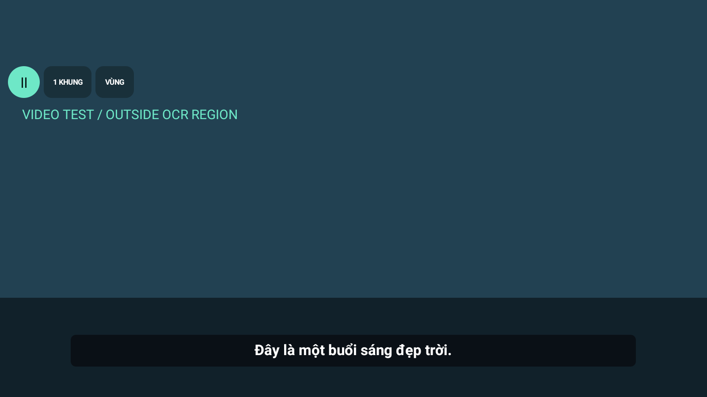
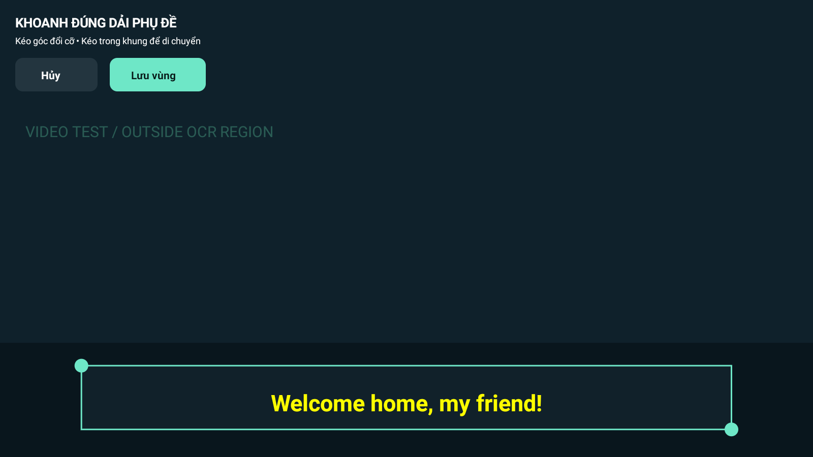
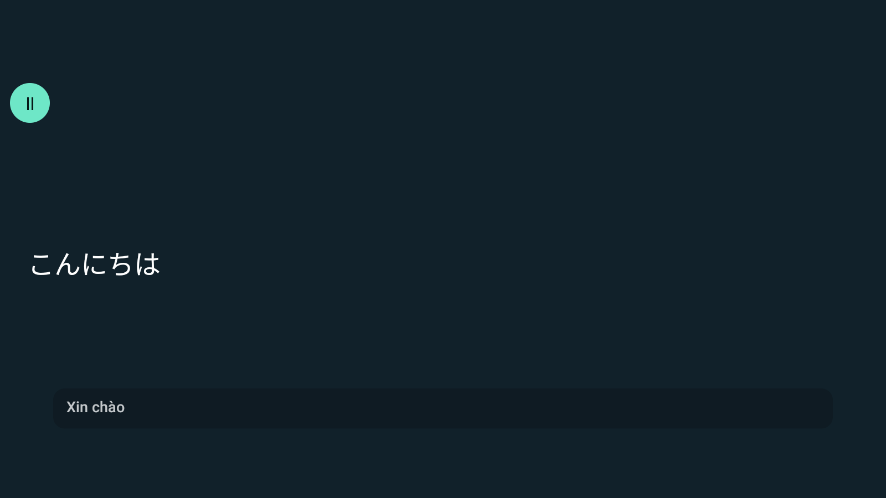

# Android / Windows 1.7.0 — AI Video Translator và Translation Memory

Xem [VIDEO_TRANSLATOR_V170.md](VIDEO_TRANSLATOR_V170.md) cho hướng dẫn, file thay đổi và bảng nghiệm thu A–J. EXE đóng gói đã chạy video mẫu có luồng phụ đề → Gemini API thật → SRT/ASS/MP4; kho được bật riêng trong DB kiểm thử, mục xác nhận được dự án thứ hai và request Live HTTP dùng lại mà không gọi thêm AI. EXE cuối còn chạy được RapidOCR Trung → TM, private Speech Anh → Gemini và khôi phục checkpoint đã hoàn tất sau clean restart không gọi mới AI. Không tự bật kho trên dữ liệu người dùng. [Bằng chứng EXE](results/video-packaged-v170.json).

RapidOCR thật trích được hai cue Trung đúng thời gian/không trùng; mẫu Nhật khớp. Mẫu OCR Hàn sai nên đường đó bị chặn. Lỗi worker đóng gói thiếu `numpy._core._exceptions` đã sửa bằng hidden import; **EXE cuối nhận đúng đoạn tiếng Anh tổng hợp và có bản dịch Gemini**, không ghi vào TM chung khi riêng tư. Chưa chấm chất lượng phim thật/đa ngôn ngữ; có bản Draft cần sửa xưng hô. Video dài hai giờ là fixture 1 fps với recognizer deterministic; chỉ đo giải mã tăng dần/bộ nhớ, không đo chất lượng phim thật.

Android `assembleRelease`/`lintDebug` và **124 JVM tests đạt**, APK 1.7.0 đã cài đè BlueStacks thành công. Backend cuối **284 tests đạt, không failure/error, 42,42 giây**, một `DeprecationWarning` Starlette; [JUnit XML](results/video-backend-v170.xml). Đã thêm regression cho race Start/Start, Start/Export và tách quyền lưu Draft khỏi quyền tra cứu TM; trước khi có admission lock hai ca race tái hiện lỗi, sau sửa chạy đạt. Giao diện có 11 ca DOM/payload với API mock và **12 kiểm tra đọc EXE thật**, không page error/mutation/Google call; [báo cáo UI](results/video-ui-real-v170.json), [ảnh](images/video-translator-v170.png). Các kết quả này chưa thay thế phép đo latency Live hoặc phim thật. [Media](results/video-media-v170.json), [Speech nguồn](results/video-speech-v170.json), [decode dài có giới hạn](results/video-long-v170.json).

Windows 1.7.0 đã cài đè, EXE khớp hash bản giao; giữ khóa API được bảo vệ, settings, pairing, chứng chỉ, usage và CLI runtime; không gọi AI khi nâng cấp. Windows smoke test bản cuối đạt. [Kết quả nâng cấp](results/windows-upgrade-v170.json).

Live priority đã kiểm tra thật qua **20 + 20 + 20 cue cache**: encoder đang export tự chuyển `waiting_live`, CPU tăng 0,0 giây trong một giây khi Live hoạt động. Playback có video chờ đạt 20/20, P95 290,10 ms; follow-up không video khi cache nóng cũng 20/20, P95 618,10 ms. Hai lượt này không vẽ câu cũ và không gọi AI mới. Baseline lạnh chỉ 18/20, một lần vẽ câu trước, P95 598,35 ms trên các cue khớp; [báo cáo](results/video-live-priority-v170.json) giữ `passed=false` cho ca so sánh và `priority_suspension_verified=true` cho gate. Không bỏ ca lạnh lỗi hoặc suy rằng chạy video làm Live nhanh hơn. Đây là cache và mẫu nhỏ, không chứng minh Gemini câu mới một giây hoặc không giảm hiệu năng với mọi phim; xem bảng đầy đủ trong báo cáo 1.7.0.

---

# Android 1.6.3 / Windows 1.6.1 — tăng tốc và dịch trước

Xem [PERFORMANCE_V163.md](PERFORMANCE_V163.md): hàng đợi API song song có giới hạn, prompt Fast/thinking minimal, RetryInfo, ổn định OCR và nhập file phụ đề để chuẩn bị cache. Phân biệt kết quả Gemini thật, cache Android và mô phỏng. Không tuyên bố mọi câu đạt 1 giây.

---

# Android 1.6.2 / Windows 1.6.0 — lịch sử khôi phục Gemini API

Máy hiện tại đã nhận khóa do người dùng cung cấp và dùng Gemini API chính thức/Flash-Lite. CLI thử nghiệm vẫn tắt. [API_RESTORE_V162.md](API_RESTORE_V162.md) ghi các phép thử mới, số đo và giới hạn. Những mục bên dưới là lịch sử theo phiên bản/provider lúc đo.

---

# Android 1.6.1 / Windows 1.5.0 — lịch sử sửa retry

Xem [RETRY_FIX_V161.md](RETRY_FIX_V161.md): sửa lỗi ghi đè nguyên nhân thành “Đang chờ thử lại Gemini” và lặp yêu cầu cấu hình mỗi 60 giây. Có test hồi quy và phép kiểm tra BlueStacks trên APK mới. API chưa bật, consumer CLI vẫn bị chặn; không tuyên bố đã khôi phục dịch câu mới.

---

# Android 1.6.0 / Windows 1.5.0 — lịch sử đo hiệu năng

Xem [PERFORMANCE_V160.md](PERFORMANCE_V160.md) cho 100+100 lượt cache, prototype local 800 inference/100 câu tham chiếu, sửa mã nguồn và kiểm thử hiện tại. Chưa xác nhận P95 ≤ 1 giây cho câu mới; local chưa đạt chất lượng, chưa triển khai Hybrid, API chưa chạy theo lựa chọn người dùng.

**Các mục bên dưới là lịch sử.** Tích hợp consumer Antigravity CLI trước đây không được Google hỗ trợ; Windows 1.5.0 đã chặn đường này, giữ cache/tài khoản/dữ liệu. Không làm theo hướng dẫn đăng nhập CLI cũ để dịch qua app. [Giải thích và nguồn Google](GOOGLE_AI_PRO.md).

---

# Android 1.5.1 — sửa trạng thái kẹt khi mất Windows

Ngày 23/10/2026. Đã tái hiện ảnh báo “Đang đọc một khung phụ đề…” trên APK 1.5.0. ADB reverse trống sau khi giả lập khởi động lại; Android vẫn ghép với 127.0.0.1:8765; Companion đã ghép ở 8766 không chạy (ConnectError). Kết nối lại ADB/khởi động đúng Companion xác nhận connected=1, giữ token/cert/dữ liệu. Không thay đổi server khác ở cổng 8866.

Lỗi mã nguồn: sendLatest() chỉ báo chưa kết nối trong nhánh oneFrame. Nhấn 1 KHUNG khi đang preset auto vẫn gọi requestFrame(), nhưng oneFrame=false. Khi OCR thành công mà mạng chưa kết nối, không có nhánh cập nhật thanh nổi nên nhãn “Đang đọc…” còn mãi. Socket send thất bại cũng chỉ trả lại quyền retry, chưa thông báo.

Đã sửa `ScreenCaptureService.kt`: cả auto/manual báo rõ đã đọc nhưng chưa nối Windows, chờ retry hoặc gửi thất bại; send thất bại không khóa quyền thử lại. Không đổi bộ dịch hoặc xác thực.

- APK 1.5.1/code 10, cùng chữ ký, đã cài đè giữ dữ liệu và xác minh hash.
- **59 kiểm thử Android đạt**, gồm 3 regression gọi sendLatest thực qua Robolectric: auto offline, manual offline, socket send thất bại cho phép retry. Lint 0 lỗi. Backend không thay đổi nên không chạy lại 58 test cũ.
- Thử thật trên BlueStacks: chủ động tắt đúng Companion khi dùng cảnh công khai `晚上好。`; ảnh xác nhận thông báo offline. Mở lại Companion, kết nối tự hồi phục và Android vẽ **Chào buổi tối.**. Provider lượt này 5235 ms; không phải phép đo cải thiện độ trễ.
- Giữ vùng hiện tại của người dùng [233,496,809,538], chỉ mở editor đọc rồi bấm Hủy. Đã đưa YouTube trở lại, không bấm phát/tua.
- `Mo-Gemini-BlueStacks.cmd` và `scripts/start_bluestacks.ps1`: mở đúng Companion, adb connect và reverse lại cổng cho BlueStacks sau khởi động. Đã chạy kiểm tra thành công. Không chạy ngầm thường trú hoặc đổi chính sách PowerShell hệ thống; script dùng UTF-8 BOM cho Windows PowerShell 5.

Sau mỗi lần mở lại BlueStacks, chạy `Mo-Gemini-BlueStacks.cmd` trong thư mục dự án này. Mặc định ADB 5555/device server 8765; script nhận tham số cổng khi dùng bản cấu hình khác. Giữ Companion mở trong lúc dịch. Các hạn chế tốc độ/OCR của 1.5.0 bên dưới vẫn còn; bản này sửa kết nối và trạng thái, không tuyên bố đạt một giây.

[Log kiểm thử JSON](results/reconnect-v151.json), [ảnh offline](images/disconnected-v151.png), [ảnh nối lại và bản dịch](images/reconnected-v151.png).

# Android 1.5.0 / Windows 1.4.0 — kiểm tra pipeline và độ trễ

Ngày 22/10/2026. Đã sửa trực tiếp dự án hiện có, build/ký/cài trên **BlueStacks Pie64 Android 9, 1600×900** và Windows. Giữ vùng **[153,428,925,478]**, ghép cặp, chứng chỉ, dữ liệu và tài khoản Google; chỉ dùng Gemini AI Pro qua Antigravity CLI 1.4.5, Fast/auto **Gemini 3.8 Flash Low**. Không thêm bộ dịch khác.

**Chưa đạt một giây cho mọi câu.** Sáu câu mới có P50 **3,351 ms**, P90 **6,027.5 ms**, P95 **6,690.25 ms** toàn luồng trên cùng đồng hồ Android. Ca A→B mất **13183 ms** cho B do chờ lượt A đang chạy; chuỗi đổi 800 ms có câu cuối mất **7326 ms**. Không loại các trường hợp chậm này khỏi báo cáo. Các percentile n=6 chỉ mô tả mẫu nhỏ, không là bảo đảm hiệu năng.

## Nguyên nhân được xác minh và sửa

1. **AI không trực tiếp chặn coroutine OCR cũ.** Tuy nhiên `pendingId` chặn gửi câu B và thanh progress lấy `pendingTexts` A; vì vậy OCR/caption người dùng thấy dễ bị lẫn với câu đang chờ. Bản mới gửi B ngay vào hộp chờ một câu của server; B/C thay thế nhau, không tồn đọng cả chuỗi. Lượt đang chạy vẫn cần hoàn tất nên độ trễ AI còn tồn tại.
2. **Nguồn trống chưa xóa state.** Nhánh blocks rỗng và `renderCurrent()` rỗng không xóa `lastOcr`/`lastTranslation`; trạng thái cache/thành công cũ còn hiện. Baseline tái hiện sau 2 giây nguồn trống. Bản mới coi nguồn trống là thế hệ màn hình mới, xóa nội dung/trạng thái và câu chờ.
3. **Đối chiếu kết quả chưa đủ.** Trước chỉ so request và signature; chưa có region/screen generation trên wire. Nay kiểm tra cả requestId, regionId, screenGeneration, signature, gồm A→B→A và reset vùng. Response metadata sai không được vào cache. Auto chỉ vẽ sau OCR của snapshot lấy sau lúc nhận response xác nhận nguồn vẫn là câu đó.
4. **Capture và OCR cùng vòng lặp; bitmap cũ chưa có hộp chờ riêng.** Nay capture sao chép riêng ROI trên handler ảnh vào channel một phần tử DROP_OLDEST; OCR có đúng một consumer trên Default, không await Gemini. Nếu đang OCR mà đã có ROI mới khác CRC, bỏ OCR cũ; giãn nhịp theo thời gian OCR để tránh bỏ liên tục khi OCR chậm. Reset/đổi vùng/xoay loại cả công việc cũ. Có source-image sequence/age riêng để phân biệt ảnh phần cứng với lần sao chép ảnh tĩnh.
5. **Cache RAM xóa tất cả khoảng trắng**, có thể trộn “now here” với “nowhere”, khác chuẩn hóa SQLite. Đã giữ ranh giới từ Latin/Hàn và namespace theo ngôn ngữ/profile/mode; reconnect/invalidate xóa cache RAM. NFKC, khoảng trắng giữa CJK và một dấu chấm cuối vẫn được chuẩn hóa để giảm OCR jitter; dấu ba chấm/gạch dưới được giữ nếu ML Kit trả về. Cache vẫn có giới hạn ngữ cảnh được mô tả bên dưới.
6. **OCR loại mọi câu một ký tự và gộp khối đa ngôn ngữ.** Đã giữ ký tự Han/kana/Hangul đơn; nhận theo dòng để tách pinyin/Việt khi có dòng CJK nguồn. Không tự đoán chữ bị thiếu.
7. **Server cũ hủy task khi request mới tới**, `finally` trong provider đóng process CLI. Hộp chờ mới cho lượt cũ hoàn tất, chặn phản hồi cũ và giữ process. Pause/dừng/quyền bị thu hồi vẫn hủy theo quy tắc an toàn; nguồn biến mất dùng cancel-preserve-session, xóa câu chờ và không render lượt cũ.

## Kiểm thử thực tế

| Kiểm tra | Kết quả |
| --- | --- |
| JVM Android | **56 tests, 0 failure/error** |
| Lint / release | **0 lỗi**, 42 cảnh báo; APK 1.5.0/code 9 cùng khóa ký |
| Backend | **58 tests đạt**, gồm mailbox A/B/C và fake CLI xác nhận cùng process |
| Windows đóng gói | Build, packaged smoke, setup verify/self-test/install-quiet đạt; EXE cài khớp dist |
| A: A đang dịch → B | A thực sự đã gọi AI và chưa hoàn tất lúc đổi B; sau đó server hoàn tất 2 frame/2 AI, chỉ B được Android vẽ; **0 lần A vẽ sau B**. B chờ mailbox **9672 ms**, provider B **2969 ms** |
| B: nguồn biến mất | OCR/state/overlay xóa trong **232 ms**; ảnh xác nhận không còn OCR/caption cũ |
| C: cùng câu 5 giây | **0** AI mới, **0** request trùng |
| Cache câu đã gặp | **227 ms** nguồn→draw, **0 AI**; smoke cuối **233 ms**. Chưa đạt cache ≤100 ms |
| Chuỗi 4 câu cách nhau 800 ms | 4 đổi nguồn, **3 AI**, lỗi 0, **0 draw câu cũ**; câu cuối **7326 ms**. Không tuyên bố dịch đủ mọi câu trung gian |
| Server → nội dung Android vẽ | 3/3 hash khớp: `小心台阶。` → **Cẩn thận bậc thang.**, `明天去。` → **Mai đi.**, `休息吧。` → **Nghỉ ngơi đi.**; kiểm tra cache không thêm AI |
| Câu một chữ | `好` nhận đúng, bản dịch được vẽ, **2842 ms** toàn luồng, 1 AI/0 lỗi |
| Nháy sau nâng cấp | Clip ≈5 giây: **77** frame giải mã, **74** đủ cảnh; **0** biến mất của nút/phụ đề trên frame đủ cảnh. **3** frame không đủ cảnh giữ nguyên, không suy diễn thành đạt toàn bộ frame |
| Bản bàn giao | Hash APK đã cài khớp tệp dist; một thiết bị kết nối, giữ tài khoản/vùng/ghép cặp; cập nhật Windows không gọi AI |

Đây là kiểm thử JVM, backend có provider giả cho race, và **Gemini thật trên máy ảo BlueStacks**. Chưa kiểm thử Redmi/Android 14+ thật. Native benchmark dùng `elapsedRealtime` của chính Android từ source onDraw đến overlay draw; không trừ timestamp Windows khỏi Android. onDraw hoàn tất chưa đo độ trễ panel/compositor. Ảnh và video kèm là cảnh thử trung tính, không kèm nội dung video người dùng. Sau cùng đã đưa YouTube trở lại, ảnh riêng cục bộ cho thấy video đang ở 0:08, không bấm phát/tua; có bản dịch Việt của câu đang thấy, 1 AI/0 lỗi thêm. Ảnh này chỉ giữ trong build, không đóng gói.

## Số đo trước / sau

Baseline là Android 1.4.1 / Windows 1.3.0, 6 câu mới, mỗi câu 1 AI, lỗi 0. Bản cũ chưa có timestamp source/overlay native hoặc timing OCR/queue nên không bịa các cột đó. Hai nhóm dùng câu khác nhau và chịu biến động dịch vụ; không đủ cơ sở tuyên bố AI nhanh hơn nhờ bản sửa.

| Chỉ số | Trước | Sau |
| --- | --- | --- |
| Server P50 / P90 / P95, n=6 | 2797 / 5226,5 / 6168,25 ms | 3,023.5 / 5,648 / 6,308 ms |
| Native nguồn→overlay P50 / P90 / P95, n=6 | Chưa đo được | 3,351 / 6,027.5 / 6,690.25 ms |
| Host ADB→server P50/P95 (proxy, không native E2E) | 3156 / 6570,5 ms | Không dùng thay native E2E |
| Capture ROI P50/P95, n=6 | Chưa đo riêng | 9.5 / 11 ms |
| OCR P50/P95, n=6 | Chưa đo riêng | 51 / 113.25 ms |
| Hàng đợi OCR P50/P95, n=6 | Chưa đo riêng | 0 / 1 ms |
| Provider Gemini/CLI P50/P95, n=6 | Chưa tách khỏi server | 3,023.5 / 6,308 ms |
| First agent text P50/P95, n=6 | Chưa đo | 2,992.5 / 6,265.75 ms |
| Transport residual P50/P95, n=6 | Chưa đo | 3.5 / 16 ms |
| Overlay ready→draw P50/P95, n=6 | Chưa đo | 37 / 57 ms |
| Response→draw gồm xác nhận OCR P50/P95 | Chưa đo | 205 / 306.5 ms |

Mỗi dòng n=6 là cùng sáu mẫu uncached; không trộn cache. Trung bình native **4056,83 ms**, P99 nội suy **7220,45 ms**, với n=6 chưa đại diện tail latency sản xuất. Sáu lượt trong 26,795 giây tương đương **13,44 lượt/phút** gồm cả khoảng chờ của bộ đo. Cache hit 0/6 trong nhóm cố ý chọn câu mới; hai lượt quay lại câu đã gặp là 2/2, 227 và 233 ms, không thể dùng tỷ lệ của cảnh thử này làm tỷ lệ dùng thực tế. `transport_residual` = khứ hồi client trừ tổng server (làm tròn có thể âm vài ms nên chặn tại 0), gồm serialization/dispatch, không phải đo riêng Wi-Fi một chiều. Ping/pong WSS đo vòng Android↔Windows độc lập, không gọi AI. `queue` server gồm mailbox + semaphore; `provider` đã gồm CLI lock, không cộng hai lần. CLI không cho tách mạng Google và compute của mô hình.

| Câu mới | Native nguồn→draw | Provider | Reuse CLI |
| --- | --- | --- | --- |
| `风有点大。` | 7353 ms | 6968 ms | false |
| `今天休息。` | 2811 ms | 2453 ms | true |
| `车快到了。` | 3603 ms | 3313 ms | true |
| `还要多久。` | 4702 ms | 4328 ms | true |
| `先买张票。` | 3099 ms | 2734 ms | true |
| `小心台阶。` | 2773 ms | 2297 ms | true |

Lượt đầu khởi tạo process **31 ms**, chờ first agent text **6922 ms**, result **6937 ms**. Năm lượt sau báo `cli_reused=true`; **không mở process mỗi câu**. First text và result chỉ cách 0–31 ms ở sáu mẫu này, nên chưa có bằng chứng streaming sẽ tiết kiệm hàng giây. Mười ping/pong cuối có khứ hồi Android↔Windows 2–12 ms, trung vị 3 ms. Fast/auto đã dùng Flash Low và effort thấp nhất mà CLI hỗ trợ. Không đổi xác thực, không đoán model/endpoint để né độ trễ.

## Giới hạn còn tồn tại

- **Một giây cho mọi câu chưa đạt.** Mẫu warm cũng chờ Gemini nhiều giây; một request mới còn có thể chờ phần còn lại của lượt đang chạy. Hộp chờ giới hạn công việc dư và giữ câu đúng, không làm mô hình trả kết quả tức thì. Nhiều câu 800 ms bị bỏ qua theo latest-wins. Mục tiêu P50≤1000/P90≤1500/P95≤2000 đều chưa đạt.
- **Dấu gạch dưới vẫn có lỗi native OCR:** cảnh `你_好吗？` bị ML Kit trả `你好吗?`; ứng dụng đã giữ nguyên kết quả nhận được nên bản dịch hiển thị “Bạn khỏe không?”. Giữ underscore trong chuẩn hóa/cache chỉ khắc phục mất dấu ở phần xử lý văn bản; chưa chữa được ký tự ML Kit không nhận ra. Không tự dựng lại từ bị thiếu hoặc tuyên bố chất lượng hoàn hảo. Cần thử tiền xử lý ảnh/engine OCR trên tập video thực có nhãn trước khi áp dụng heuristic để tránh thêm dấu sai và tăng độ trễ.
- **Giản thể/phồn thể:** một thử A đầu dừng vì ML Kit đọc `来` thành `來`; lưu lỗi công cụ kiểm thử/ảnh và nguyên nhân, không đổi hash để giả là nhận đúng. Sáu mẫu thời gian ban đầu giữ nguyên, A/B được chạy bằng câu mới khác. Đây là vấn đề nhận dạng; bản dịch khi đó vẫn đúng nghĩa.
- Cache theo nguồn đã nhận, ngôn ngữ/profile/mode/model/từ điển, không đảm bảo cùng câu trong ngữ cảnh khác phải có cùng cách dịch. Ký tự không được OCR nhận ra cũng không thể phân biệt bằng khóa text. Dùng ROI gọn, đúng dòng/ngôn ngữ và từ điển cho tên riêng; chưa dùng fuzzy cache hoặc đoán câu thiếu.
- CRC toàn ROI có thể khác do nền video, không chỉ do glyph. Nhịp capture giãn theo OCR để tránh bỏ mãi khi OCR chậm; giới hạn một OCR/hộp chờ một frame vẫn áp dụng. Phải đo thêm phim có nền chuyển động, không suy từ cảnh thử phẳng ra mọi phim.

## Chạy lại

Build và kiểm thử thông thường:

```powershell
python scripts/build_android.py assembleRelease assembleDebugAndroidTest testDebugUnitTest lintDebug
python scripts/sign_apk.py
$env:PYTHONPATH='.python-deps;windows-server'
python -m pytest -q
```

Cài APK chính cùng chữ ký và APK test độc lập, bật capture trên cảnh thử. Giữ ROI hoặc truyền `--roi left top right bottom`. Mặc định script dùng ROI cảnh đo 1600×900 này. Chọn danh sách câu công khai **chưa có trong cache** và A/B mới để ca A thực sự đang gọi AI; không xóa cache người dùng để làm đẹp số đo:

```powershell
python scripts/benchmark_subtitle_pipeline.py --rapid --output build/my-pipeline.json --samples-file build/fresh-public-phrases.json --fresh-a 'câu A mới tiếng Trung' --fresh-b 'câu B mới tiếng Trung'
```

Script kiểm tra AI call count, tách fresh/cache, dừng nếu hash OCR không khớp chữ mẫu; không sửa ngầm văn bản để cho qua. Nếu cần hoàn tất checks sau lỗi công cụ, `--resume <json> --checks-only` giữ số đo cũ. Đo server riêng: `scripts/benchmark_companion.py`; không chạy đồng thời native benchmark vì cùng dùng lock CLI. Tất cả thao tác admin đọc bearer từ dashboard.url nội bộ, không in token. Trace chỉ có hash/timing/ID, không có nguyên văn màn hình hoặc credential.

## File thay đổi

Các đường dẫn rút gọn `capture/`, `ocr/`, `overlay/`, `network/`, `SessionState.kt`, `MainActivity.kt` bên dưới thuộc `android-app/app/src/main/java/com/gemini/ocr/`.

- `android-app/app/src/main/java/com/gemini/ocr/capture/ScreenCaptureService.kt`: producer/consumer, hộp chờ một bitmap, một OCR nền, CRC bỏ khung cũ, nhịp thích ứng; trạng thái nguồn trống; hộp chờ dịch mới nhất; đối chiếu metadata và OCR sau response.
- `capture/SubtitlePipeline.kt` (mới): thế hệ câu, vùng, request và dedup; `capture/SubtitleText.kt`: sửa khóa làm mất khoảng cách từ Latin/Hàn, giữ gạch dưới và câu chưa đầy đủ; `capture/SubtitleRegion.kt`: lọc dòng pinyin/Việt khác dòng chữ nguồn khi nhận được dòng CJK.
- `capture/PipelineTrace.kt` (mới): trace đồng hồ monotonic, hash nguồn/kết quả, không ghi nguyên văn hoặc credential.
- `ocr/OcrProcessor.kt`: nhận từng dòng thay vì gộp khối đa ngôn ngữ; giữ câu CJK một ký tự; xử lý ML Kit trên dispatcher nền.
- `overlay/TranslationOverlay.kt`: callback sau draw thực tế, giữ render key chống vẽ/ẩn lại không cần thiết.
- `network/TranslationClient.kt`, `SessionState.kt`, `MainActivity.kt`: ping/pong khứ hồi và số đo từng giai đoạn.
- `android-app/app/build.gradle.kts`: release 1.5.0/code 9, giữ application ID và chữ ký.
- `android-app/app/src/test/java/com/gemini/ocr/capture/SubtitlePipelineTest.kt` (mới), `SubtitleTextTest.kt`, `SubtitleSourceRowsTest.kt` (mới): A/B/C, A→B→A, vùng, retry, metadata, va chạm cache, lọc dòng.
- `android-app/app/src/androidTest/java/com/gemini/ocr/TestSceneActivity.java`: cảnh thử độc lập, ghi thời điểm chữ được vẽ, chuỗi câu và vị trí tương ứng ROI.
- `windows-server/app/models.py`, `server.py`: metadata tùy chọn, capability, một tác vụ đang chạy và một câu chờ mới nhất, bỏ phản hồi cũ, cancel-preserve-session.
- `windows-server/app/manager.py`, `telemetry.py` (mới), `antigravity_provider.py`: đo queue/cache/provider/start/first-output/result; đo theo từng request, xác nhận tái sử dụng process.
- `windows-server/app/__init__.py`, `windows-server/installer.py`, `scripts/smoke_windows.py`: Windows 1.4.0, phiên bản bộ cài/registry và smoke.
- `tests/test_pipeline_telemetry.py` (mới), `tests/test_antigravity_provider.py`: race/mailbox/cancel/dedup, phân lập timing và cùng process qua hai yêu cầu.
- `scripts/benchmark_companion.py`, `scripts/benchmark_subtitle_pipeline.py` (mới): đo có thể chạy lại, tách cache/fresh, đối chiếu bản dịch server với hash nội dung đã draw trên Android; resume giữ nguyên số đo đầu. `shared/PROTOCOL.md`, `shared/protocol.json`: tài liệu capability/metadata/mailbox/timing và schema khớp model hiện tại.
- `README.md`, `docs/CHANGELOG.md`, `docs/SUBTITLE_MODE.md`, `docs/GOOGLE_AI_PRO.md`, `docs/REDMI_NOTE13_PRO_5G.md`, báo cáo này và JSON/ảnh/video cảnh thử: cập nhật hướng dẫn và bằng chứng.

[JSON baseline](results/pipeline-baseline-v141.json), [JSON native và A/B/C](results/pipeline-device-v150.json), [OCR một ký tự/gạch dưới](results/pipeline-quality-v150.json), [smoke bản cài/hash/nháy](results/pipeline-final-v150.json), [clip cuối](results/flicker-media/pipeline-final-v150.mp4).



## Lịch sử kiểm tra các bản trước

# Android 1.4.1 — bỏ nháy phụ đề tự động

Ngày 22/10/2026. Kiểm tra trên **BlueStacks Pie64 / Android 9, 1600×900**; Windows vẫn **1.3.0**, giữ đăng nhập Google AI Pro, ghép cặp và vùng OCR. Chỉ dùng Gemini, không thêm bộ dịch cục bộ. Phạm vi lượt sửa này là nháy màn hình; không tuyên bố nghiệm thu mục tiêu P50 ≤ 1 giây trong tài liệu tham khảo.

**Nguyên nhân xác nhận trong mã:** mỗi vòng thu toàn màn hình gọi `sampling(true)`, ẩn dải dịch và đặt alpha thanh nút về 0, rồi chờ 80 ms trước khi OCR. Với chu kỳ nghỉ 150 ms, thao tác này lặp liên tục. App còn gọi lại layout/wrap và gán cùng nội dung phản hồi ở nhiều vòng OCR.

**Cách sửa:** tự động thu toàn màn hình đặt dải Việt sát ngoài toàn bộ vùng OCR, ưu tiên phía trên. Thanh nút cũng nằm ngoài vùng đó và tránh dải dịch. Bỏ ẩn/hiện định kỳ trên đường này, giữ nguyên dải khi chữ/vùng không đổi, bỏ cập nhật phản hồi giống hệt. Khi thiếu chỗ, hiện hướng dẫn thu hẹp VÙNG. Vùng người dùng `[100,435,938,515]` được giữ nguyên. Dịch từng **1 KHUNG** vẫn giữ kiểu phủ chữ gốc; chia sẻ một ứng dụng trên Android 14+ có thể giữ kiểu phủ mà không thu lớp nổi, theo [tài liệu Android](https://developer.android.com/media/grow/media-projection). Chưa chạy lại đường Android 14+ trên thiết bị thật trong lượt này.

| Kiểm tra | Kết quả |
| --- | --- |
| Android JVM | **41 passed**, gồm hình học đặt dải ngoài ROI, không ẩn khi sampling, hộp OCR rung nhẹ, kéo thanh nút, vùng không đủ chỗ, relayout và 1 KHUNG |
| Build / Lint | Release **1.4.1 / code 8**, lint không lỗi; chữ ký và hash bản cài được xác minh |
| Trước sửa, video ≈5,03 giây | 78 frame mã hóa, 76 frame đủ cảnh thử; **31** lần đổi trạng thái ẩn/hiện, **16** lần đang hiện rồi biến mất của cả thanh nút và phụ đề |
| Lần quay xác nhận sau sửa ≈8,06 giây | **92/92** frame đủ cảnh thử: phụ đề và thanh nút luôn thấy, **0** lần biến mất, không có frame không phân loại |
| Smoke APK bàn giao, ≈7,79 giây | 33 frame, 31 đủ cảnh thử; **0** lần biến mất sau khi đã hiện. Có 1 frame đầu chưa có phụ đề và 2 frame không đủ cảnh thử, giữ nguyên trong dữ liệu thô |
| Nhận câu mới khi lớp dịch luôn hiện | `我们明天见。` → **Ngày mai gặp lại nhé.**, `请打开门。` → **Làm ơn mở cửa ra.**; mỗi câu 1 lượt AI, lỗi 0 |
| Giữ nguyên câu trong lần quay 8 giây | **0** lượt AI, **0** frame gửi Windows, **0** lỗi thêm |
| Bản cài cuối | APK khớp SHA-256 tệp bàn giao; giữ ghép cặp/vùng OCR; câu đã gặp qua cache không thêm lượt AI; đã quay lại ứng dụng YouTube mà không bấm điều khiển phát |

Các video có tốc độ khung biến thiên (VFR), nên không quy số frame thành FPS cố định. Phép phân loại dùng vòng tròn xanh và nền dải Việt trên cảnh thử trung tính, có kiểm tra nền cảnh thử; mọi số đếm thô và frame không phân loại được ghi rõ. Lần quay sau sửa đầu tiên có một frame thiếu phần lớn cảnh thử, chưa xác định nguyên nhân; không tự kết luận đó là nháy của app. Lần quay xác nhận 92 frame không có trường hợp này. Smoke bản cuối tách việc phụ đề xuất hiện lần đầu khỏi biến mất sau khi đã hiện.

[Kết quả JSON đầy đủ](results/no-flicker-v141-verification.json), [video trước](results/flicker-media/blink-caption-before-v140.mp4), [video xác nhận sau](results/flicker-media/blink-caption-after-confirm-v141.mp4), [smoke APK cuối](results/flicker-media/blink-caption-final-v141.mp4).



**Độ trễ AI vẫn còn:** hai câu mới đo tới kết quả server 10,437 và 2,547 giây (server 10.250 và 2.219 ms), khác trạng thái khởi động/ngữ cảnh. Đây không phải so sánh tăng tốc hay p50/p95. Lượt sửa bỏ thời gian ẩn 80 ms của đường phụ đề tự động, không biến Gemini thành dịch dưới 1 giây. Chưa đo TTFT/RTT hoặc Redmi thật. Backend không đổi nên không chạy lại 52 kiểm thử Python đã đạt ở 1.3.0.

Tái phân tích các clip đã kèm (cần PyAV 19.0.2 và Pillow trong môi trường công cụ, không phải dependency APK):

```powershell
python scripts/analyze_overlay_flicker.py docs/results/flicker-media/blink-caption-before-v140.mp4 docs/results/flicker-media/blink-caption-after-confirm-v141.mp4 --output build/flicker-check.json
```

Script chỉ áp dụng mặc định cho cảnh thử 1600×900/vùng và màu đã mô tả; có tham số đổi hình chữ nhật kiểm tra. Không dùng trực tiếp để kết luận về video bất kỳ. Ảnh/video YouTube của người dùng chỉ giữ cục bộ trong build, không đóng gói. Các phần dưới là lịch sử.

# Xác minh Android 1.4.0 / Windows 1.3.0 — Tự động tăng tốc

Ngày 22/10/2026, Asia/Saigon. Chỉ dùng Gemini qua tài khoản Google đã đăng nhập trong Antigravity CLI chính thức 1.4.5. Không thêm bộ dịch cục bộ hoặc chuyển dịch vụ. Các cảnh phụ đề trong phép đo mới đều là cảnh thử trung tính trên BlueStacks Pie64 / Android 9.

**Đã cải tiến:** Fast/auto chọn Gemini 3.8 Flash Low; stdin stream-json giữ phiên riêng từng thiết bị/cấu hình. Android nghỉ 150 ms giữa lượt quét, sao chép trực tiếp phần RGBA của vùng phụ đề thay vì cả màn hình. App dùng cache cho câu lặp, cho phép cache hiện khi lượt AI cũ còn chạy, và gửi ngay câu mới nhất khi Gemini xong; bỏ các câu trung gian. Chu kỳ thực còn cộng thời gian OCR và 80 ms ẩn overlay trong chế độ toàn màn hình.

**Lỗi phát hiện và sửa trong quá trình tối ưu:** Antigravity 1.4.5 có thể giữ structured_output của lượt trước dù response đã là câu mới. Bản mới gắn mã ngẫu nhiên mỗi yêu cầu, nhận đầu ra khớp mã và bỏ/đặt lại phiên khi thiếu hoặc sai. Prompt hiện thống nhất schema có request_id, không còn chỉ yêu cầu translations trong agent. Bộ đếm token streaming là tích lũy: chỉ cộng chênh lệch từng lượt. Cấu hình đổi, ngắt thiết bị hoặc tắt ghi nhớ không tái sử dụng hội thoại cũ.

| Phép thử thực tế | Kết quả |
| --- | --- |
| Python / backend | **52 passed**, một cảnh báo deprecation Starlette/AnyIO |
| Android JVM | **25 passed**, gồm preset tự động giữ ngôn ngữ, ghép cặp và vùng tùy chỉnh |
| APK / lint | Release **1.4.0 / code 7**, Android lint không lỗi; chữ ký v2/v3 đạt; APK cài BlueStacks khớp SHA-256 tệp bàn giao |
| Windows đóng gói | Smoke EXE đạt: HTTPS/WSS, QR, chứng chỉ, một phiên app, cổng bị chiếm, glossary, DPAPI, thu hồi và shutdown; bộ cài verify/self-test/cập nhật đạt |
| Cập nhật đã cài | Windows **1.3.0**, EXE khớp SHA-256 bản bàn giao, giữ chứng chỉ/thiết bị ghép cặp/lượt dùng; trần nội bộ nâng 15 → 60 lượt/phút, trần ngày giữ 500 |
| Windows gọi Gemini mới | `こんにちは` → **Xin chào**, **9.484 ms**, không cache, một lượt AI, lỗi 0 |
| Android tự dịch lượt đầu | `今天的天气真好。`, phía server **8.125 ms**, tới server trả kết quả **9,407 giây**, một lượt AI, lỗi 0 |
| Ba câu tự đổi tiếp theo | **5,266 / 2,968 / 4,312 giây** tới kết quả server; server **4.703 / 2.438 / 3.890 ms**; mỗi câu đúng một lượt AI và hiện chữ Việt đè chữ Trung |
| Đổi ba câu khi AI đang chạy | Hai lượt AI, bỏ câu giữa; **5,234 giây** tới kết quả câu cuối, server lượt cuối **2.250 ms**, lỗi 0; ảnh xác nhận đúng câu cuối |
| Câu lặp trong RAM | Hiện đúng **Sáng mai gặp lại nhé.** trong **0,781 giây**; pixel dải chữ khớp ảnh đã kiểm tra; **0** lượt AI và **0** frame gửi Windows |
| Cache khi lượt AI cũ đang chờ | Đúng câu hiện tại trong **0,593 giây**, so khớp pixel dải chữ; lượt cũ hoàn tất không ghi đè câu mới, không tạo lượt AI thứ hai |
| Giữ nguyên 30 giây | **0** lượt AI, **0** frame server và **0** lỗi thêm |

[Kết quả đo chi tiết](results/gemini-turbo-v140-verification.json). Thời gian “tới kết quả server” gồm chuyển cảnh thử và phát hiện kết quả bằng polling; không phải đo chính xác lúc pixel đầu tiên được vẽ. Ảnh sau đó xác nhận có bản dịch đúng. Phép cache đo tới ảnh dải chữ đúng. Những mẫu nhỏ này không phải benchmark p50/p95 hoặc cam kết độ trễ. Ảnh chụp trúng lúc overlay tạm ẩn không được dùng làm chứng cứ đã thấy phụ đề.





**Giới hạn:** chưa đạt dịch tức thời dưới một giây cho câu mới. Phụ đề tồn tại 1–2 giây có thể đổi trước Gemini; không có hàng đợi mọi câu đã qua. Lượt đầu, đổi cấu hình, hết 3 phút rỗi hoặc xoay phiên sau 32 câu/32 KB có thêm thời gian khởi động. Toàn màn hình vẫn có thể chớp overlay; ưu tiên chia sẻ một ứng dụng trên Android 14+. Chưa kiểm Redmi thật/LAN điện thoại/pin/nhiệt; bộ bảy bài native Android 15 cũ chưa chạy lại. AI Pro vẫn có hạn mức Google; không bật G1 credits hoặc tự chuyển API.

Các phần dưới là lịch sử của các phiên bản trước.

# Xác minh APK 1.3.1 / Companion Windows 1.2.1

Ngày 22/10/2026. Kiểm tra trực tiếp khung trình duyệt tiếng Trung người dùng báo không dịch được trên BlueStacks Android 9.

**Chẩn đoán:** kết nối WSS và xác thực Google vẫn hoạt động, app đã chọn đúng OCR Trung. Cache Windows có bản dịch của chính câu `亏你还是韩国人`. Thử lại khung đang dừng đã hiển thị phụ đề tiếng Việt. Không tái hiện được crash hay kẹt vĩnh viễn tại thời điểm kiểm tra. Bản cũ chỉ hiện nút `ĐỢI AI` bị khóa, không có số giây, chữ OCR hoặc lỗi trên thanh nổi; điều này khiến quá trình chờ AI khó phân biệt với app không hoạt động.

**Đã sửa:** thanh nổi hiện chữ OCR và thời gian chờ; nút chờ chuyển thành **HỦY** có thể nhấn, sau khi hủy/kết thúc/lỗi trở lại **1 KHUNG**. Thông báo OCR trống, mất kết nối và lỗi AI hiện trên video. Màn hình chính có **Khung vừa đọc**, chỉ giữ trong RAM của phiên. Kết quả cũ khi câu tự động đã đổi không còn báo nhầm là đã hiển thị câu mới.

| Kiểm tra | Kết quả |
| --- | --- |
| Android JVM | **24 passed**, gồm hồi quy hủy/thử lại, chữ OCR/lỗi trên overlay và chi tiết khung Trung |
| Release | **1.3.1 / code 6**, Lint không lỗi, chữ ký v2/v3 đạt; APK đã cài khớp SHA-256 tệp bàn giao |
| Đúng khung trình duyệt của người dùng | OCR `亏你还是韩国人` → **Thế mà cũng là người Hàn Quốc**, phụ đề đè chữ gốc được xác nhận trực quan |
| AI thật, không cache | Tạm chọn Smart để có khóa cache khác; đúng **1 lượt AI**, cache hit 0, lỗi 0; máy chủ **9.703 ms**, đo tới kết quả **10,66 giây** |
| Khôi phục cấu hình | Trả về Fast như ban đầu, giữ nguyên Trung/vùng OCR/ghép cặp; thử lại hiện bản dịch qua cache, không thêm lượt AI |
| Vùng trống | Cảnh thử trống trong cùng vùng: hiện cảnh báo rõ trên thanh nổi, không gọi AI |
| Hủy/thử lại | Kiểm thử Android JVM xác nhận nút luôn nhận nhấn khi chờ, gọi nhánh hủy và chuyển về chụp lại; không gửi thêm lượt Google chỉ để thử hủy |

[Kết quả build/kiểm thử](results/android-v131-verification.json), [kết quả khung Trung thực tế](results/chinese-v131-real-verification.json). Ảnh toàn trang của người dùng chỉ giữ trong thư mục build cục bộ, không kèm gói mã nguồn. Ảnh cảnh thử trống:



**Giới hạn còn lại:** 1 KHUNG dịch một câu mỗi lần nhấn. Muốn tự đổi câu cần chọn Tự động trước khi bật dịch. Độ trễ AI vẫn nhiều giây; bản sửa này không biến CLI thành dịch phim tức thời. Chưa nghiệm thu trên Redmi thật. Backend Windows không đổi nên không chạy lại 48 bài Python của 1.2.1.

# Lịch sử: xác minh APK 1.3.0 / Companion Windows 1.2.1

Ngày 22/10/2026, BlueStacks Pie64 / Android 9. Companion Windows giữ nguyên bản 1.2.1 đã cài; bản cập nhật này nằm trong Android.

| Hạng mục | Kết quả bản cuối |
| --- | --- |
| Android JVM | **21 passed**: ổn định/cache 6, vùng phụ đề 3, chống gọi lặp/đọc lớp dịch 3, giao diện 5, TLS 4 |
| Build / Lint / chữ ký | Release **1.3.0, versionCode 5**, Lint không lỗi, chữ ký v2/v3 đạt; APK đã cài có SHA-256 khớp tệp bàn giao |
| Dịch một khung bằng AI thật | `This is a beautiful morning.` → **Đây là một buổi sáng đẹp trời.**; một lượt AI, một đoạn, **15,80 giây** tới kết quả máy chủ; phía máy chủ **15.390 ms** |
| Dịch lại cùng khung | Phụ đề hiện lại khoảng **0,98 giây**, không thêm yêu cầu Windows hoặc AI |
| Vùng OCR | Kéo/chỉnh và lưu thành công: `[160,720,1440,846]` trên màn hình 1600×900 = **11,2% diện tích**; OCR lượt sau **37 ms** |
| Số khung | Hai lần chạm đọc đúng **hai khung**; video đổi trong chế độ một khung không tự OCR thêm |
| Che chữ gốc | 6.582 pixel vàng của phụ đề nguồn giảm về **0** sau khi phủ; ảnh xác nhận chữ Việt căn giữa trong dải nền kín |
| Tự động, đổi khi AI đang chạy | Hai câu mới tạo đúng **hai lượt**, hoàn tất khoảng **22,17 giây**, hiển thị câu mới nhất đúng; lỗi 0 |
| Giữ phụ đề đứng yên | Theo dõi thêm **30 giây**, không thêm lượt AI |

[Kết quả Android tự động](results/android-v130-verification.json), [một khung](results/subtitle-oneframe-final-verification.json), [tự động](results/subtitle-auto-final-verification.json). Các số đo từng lượt không phải benchmark p50/p95 hoặc cam kết tốc độ.





Trong quá trình thử, một cảnh Nhật không đọc được vì app đang chọn OCR Anh; đã đổi cảnh thử cho khớp ngôn ngữ. Kiểm tra tự động ban đầu có thêm một lượt khi câu đứng yên; bản cuối bổ sung chuẩn hóa khoảng trắng/dấu chấm, ẩn cửa sổ phủ khi lấy ảnh và chặn văn bản trùng bản dịch. Phép thử hai câu và giữ 30 giây ở trên chạy sau khi sửa.

**Giới hạn:** tối ưu này giảm diện tích/số lần OCR và tránh hủy/gọi lặp. Nó không làm Antigravity trả lời tức thời: các lượt mới đo trong phiên phát triển khoảng 10–16 giây; lượt cuối 15,8 giây. Phụ đề đổi nhanh vẫn có thể chạy trước AI, nên dừng video và dùng **1 KHUNG**. Chưa thử Redmi thật, Wi-Fi điện thoại hoặc cơ chế chạm của dải phủ trên Android 12+; BlueStacks kiểm tra ở Android 9. Bộ bảy bài native Android 15 cũ chưa chạy lại cho 1.3.0. Không sửa backend Windows nên không chạy lại 48 bài Python đã đạt ở 1.2.1.

Cách dùng: [SUBTITLE_MODE.md](SUBTITLE_MODE.md). Dữ liệu và ghép cặp được giữ khi cập nhật APK, không sửa cấu hình hệ thống ngoài dự án.

# Lịch sử: xác minh bản 1.2.1

Ngày 22/10/2026, Asia/Saigon. Phân biệt kiểm thử tự động và gọi AI thật.

| Nhóm | Kết quả hiện tại |
| --- | --- |
| Python/FastAPI | **48 passed**, một cảnh báo deprecation Starlette/AnyIO |
| Android JVM / Robolectric Android 14 | **14 passed**: giao diện/ghép cặp, ổn định/cache, TLS/chứng chỉ |
| APK release | Build, Android Lint và chữ ký v2/v3 đạt; versionCode **4**, versionName **1.2.1** |
| Windows EXE đóng gói | Smoke đạt: thiết lập CLI, một phiên, cổng bị chiếm, HTTPS/chứng chỉ/QR/WSS, glossary, DPAPI, thu hồi, cache, tắt máy chủ |
| Bộ cài Windows | Payload, layout tự kiểm tra và cài cập nhật cho người dùng hiện tại đạt; giữ dữ liệu/ghép cặp |
| Antigravity chính thức | CLI **1.4.5**, SHA-512 khớp manifest Google; tài khoản đã đăng nhập gọi AI thành công |
| Windows đã cài | API `/api/translate` HTTP 200, `こんにちは` → `Xin chào`, **11.547 ms**, kết quả mới, không lấy cache |
| BlueStacks thực tế | Pie64 / Android 9 (SDK 28), APK release 1.2.1: OCR → WSS → Antigravity → phụ đề **Xin chào**, khoảng **14,19 giây** |

Tổng **62 bài tự động** trong hai nhóm Python/JVM. Smoke EXE, bộ cài và các phép thử AI thật là kiểm tra bổ sung, không cộng trùng. Bảy bài native Android 15 đã đạt ở 1.2.0 với cùng mã capture; chưa chạy lại bộ bảy bài đó ở 1.2.1 nên không tính vào tổng hiện tại.

## Bằng chứng dịch thật

1. Provider gọi Antigravity bằng tài khoản Google đã đăng nhập: `こんにちは` → `Xin chào`, 8,53 giây, 5.167 input / 39 output token do CLI báo. [Kết quả](results/antigravity-japanese-verification.json).
2. Companion Windows cài tại `%LOCALAPPDATA%\Programs\GeminiOCR`, phiên bản 1.2.1: API trả bản dịch đúng trong 11,55 giây. [Kết quả](results/windows-japanese-verification.json).
3. APK release đã ký cập nhật bằng `adb install -r`, giữ nguyên ghép cặp. BlueStacks kết nối `127.0.0.1:5555`; ADB reverse chuyển 8765 tới companion. Nguồn OCR chọn Nhật, profile Game, mode Smart. Activity thử riêng hiển thị `こんにちは`; ML Kit nhận chữ, gửi WSS, Windows gọi AI rồi Android vẽ `Xin chào`. Số lượt gọi tăng 17 → 18, đoạn dịch tăng 1 → 2, cache hit 0, lỗi 0; độ trễ phía máy chủ của lượt này 11.313 ms. [Kết quả](results/bluestacks-e2e-verification.json).



Thời gian toàn luồng được đo từ khi mở cảnh thử đến lúc nhận kết quả; ảnh chụp sau đó xác nhận phụ đề xuất hiện. Đây là một lượt, không phải p50/p95. Tên thiết bị `OnePlus NE2211` do BlueStacks báo, không đại diện Redmi.

## Lỗi đã sửa

- Gemini CLI cũ trả `UNSUPPORTED_CLIENT` cho tài khoản cá nhân. Chuyển production provider sang Antigravity CLI; tải từ Google, xác minh SHA-512, không đóng gói Node/CLI cũ.
- CLI nhận sai nội dung và trả đường dẫn workspace. OCR hiện đi qua stdin stream JSON với chỉ dẫn rõ trường `items`; app kiểm tra số đoạn/kiểu/độ dài và chặn đường dẫn mới xuất hiện.
- CLI 1.4.5 có thể lặp nguyên bộ JSON trong `response` và không có `structured_output`. Parser chấp nhận tối đa 16 bản giống hệt; từ chối bản mâu thuẫn hoặc thiếu đoạn.
- Cấu hình hạn chế công cụ đặt trong hồ sơ riêng của tiến trình con; không sửa cấu hình CLI người dùng. Kiểm tra `/permissions` thật xác nhận các luật deny. Danh sách công cụ trong sự kiện `init` là registry toàn cục; các sự kiện gọi tool thực tế bị từ chối.
- Lối tắt Windows dùng tên **Gemini OCR Windows**, xóa đối số cũ khi tạo shortcut; lối tắt BlueStacks được giữ riêng.

## Phạm vi còn lại

- Chưa chạy trên Redmi Note 13 Pro 5G: chưa đo firmware HyperOS/MIUI, pin, nhiệt độ, chất lượng OCR game thực hoặc Wi-Fi giữa hai máy.
- BlueStacks dùng cầu ADB reverse theo phiên; sau khi khởi động lại cần khôi phục theo [hướng dẫn](GOOGLE_AI_PRO.md). Đây không phải kiểm thử LAN/Firewall với điện thoại thật.
- CLI hiện khoảng 8–12 giây phía AI/máy chủ trong các lượt đã đo; toàn luồng khoảng 14 giây. Chưa đạt tức thời, chưa có thống kê tải dài hoặc chất lượng nhiều câu.
- CLI có thể lưu văn bản OCR trong hội thoại riêng; dự án không tự xóa dữ liệu đó. App không đọc OAuth/keyring và không lưu ảnh.
- EXE chưa có chữ ký Authenticode; chưa nghiệm thu cài/gỡ trên Windows sạch. Cài cập nhật trên máy hiện tại đã thành công.

## Kiểm thử native trước đó

Bộ Android 15 ở 1.2.0 đã kiểm tra 5 OCR tổng hợp (Anh, Nhật, Trung, Hàn, HUD số), Keystore/TLS/WSS, MediaProjection và pixel phụ đề, màn hình tĩnh, đồng hồ thay đổi, pause/resume/cache, xoay màn hình, loại trừ package và khóa màn hình. Các bản dịch ở bộ này dùng glossary, không dùng AI. Ảnh `android-native-overlay.png`/`android-native-landscape.png` là bằng chứng của bộ đó; `android-home.png`/`android-settings.png` là render Robolectric. Các ảnh Windows cũ trong thư mục images không đại diện UI 1.2.1.

Lệnh kiểm thử/build trong README. Không đưa token, khóa, chứng chỉ riêng hoặc dữ liệu tài khoản vào báo cáo này.
